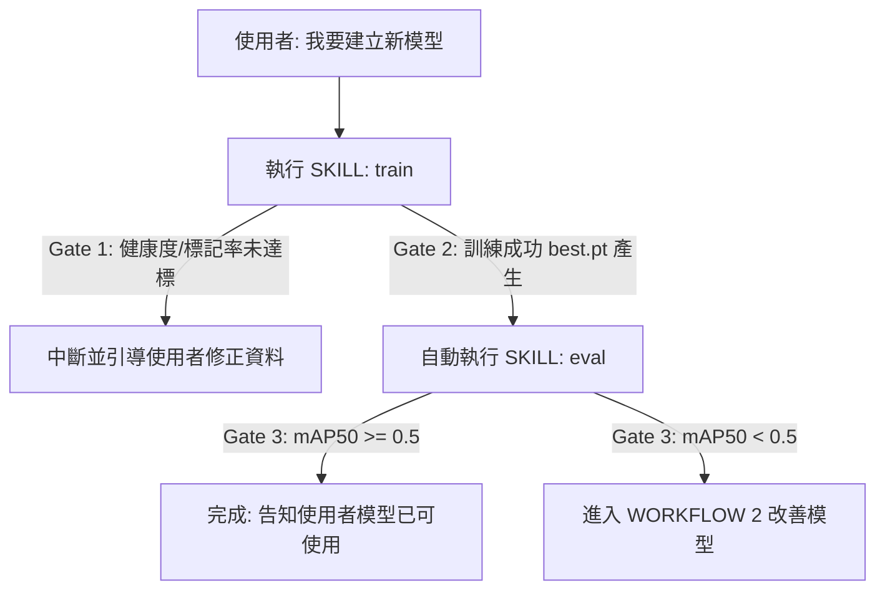

# AI Detector — Workflows 與情境規範 (WORKFLOW.md)

本文件定義 Agent 在面對使用者不同層級的需求（Jobs）時，如何串接並執行相關的 **Skills (`train`, `infer`, `eval`)**，並定義決策分支。

---

## WORKFLOW 1：建立新辨識模型 (對應 JOB-1)

此情境發生於使用者想從零建立全新模型。

### 步驟與決策分支

### 狀態變更 (workspace_state.json)
- 執行 `train` 成功後，更新 `model.trained = true` 與 `model.best_model_path`。
- 執行 `eval` 通過後，更新 `model.evaluation.passed = true`。

---

## WORKFLOW 2：改善現有模型準確率 (對應 JOB-2)

此情境發生於模型已訓練完成，但評估未達標或使用者抱怨不準。

### 步驟與決策分支
1. **診斷階段**：呼叫 `eval` Skill 獲取診斷報告（`evaluation_result`）。
2. **決策路徑**：
   - **路徑 A（資料缺失）**：若診斷指出特定類別樣本過少（`DATA_SKEW`），Agent 指出該類別，停止流程並引導使用者在網頁介面上補齊該類別的標記，補齊後重新觸發訓練。
   - **路徑 B（訓練不足）**：若 Loss 尚未收斂且無過擬合，建議調高 `epochs` 重新執行 `train` Skill。
   - **路徑 C（過擬合）**：若診斷出 `OVERFITTING`，建議調低 `epochs` 或使用更輕量的預訓練模型，重新執行 `train` Skill。
3. **驗證階段**：新訓練完成後，再次呼叫 `eval` 驗證，直到通過。

---

## WORKFLOW 3：快速圖片辨識 (對應 JOB-3)

此情境發生於使用者只想辨識指定圖片。這是一個超輕量、完全獨立的流。

### 步驟與決策分支
1. **模型選擇確認**：
   - Agent 讀取 `workspace_state.json`。
   - 若 `model.trained == true`，使用 `model.best_model_path` 作為輸入。
   - 若無，使用預置的 `models/yolov9m.pt`。
2. **推論執行**：呼叫 `infer` Skill，回傳辨識結果與帶有偵測框的圖片。

---

## WORKFLOW 4：追加資料後重新訓練 (對應 JOB-4)

此情境發生於使用者上傳了新的訓練圖片，希望併入現有模型。

### 步驟與決策分支
1. **資料併入驗證**：Agent 確認新圖片已進入對應的 `data/datasets/<DATASET_NAME>` 目錄。
2. **執行訓練**：呼叫 `train` Skill（因目錄下有了新圖片，`train` 內部的 `list_unlabeled` 與 `analyze_health` 將會對**合併後**的新資料集重新進行 Gate 驗證）。
3. **效果評估**：訓練完成後呼叫 `eval` Skill，確保新加入的資料沒有造成整體精度下滑。
