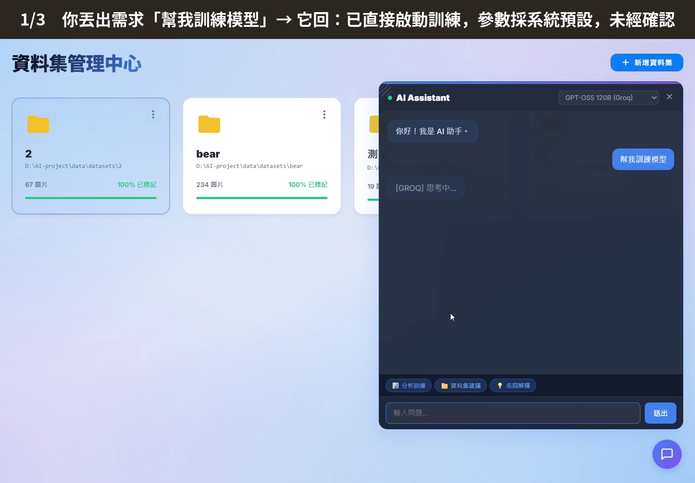
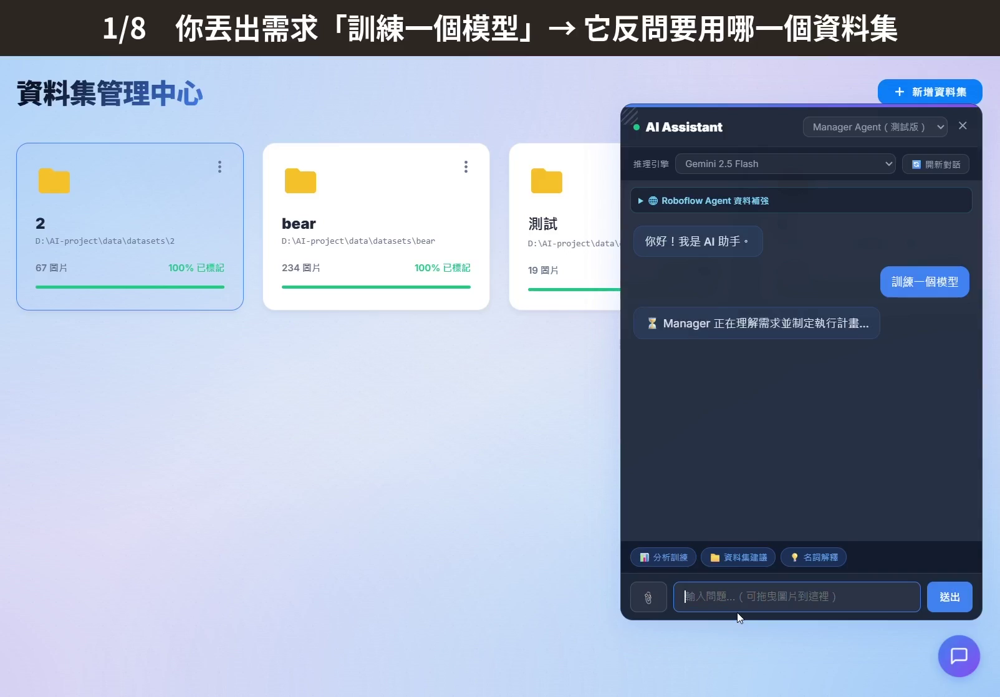
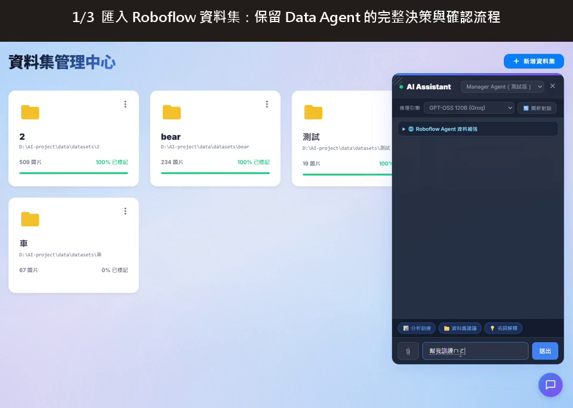

# AI Detector

AI Detector 是一個以 Python、YOLO 與 LangGraph 建立的本機影像辨識工具。我希望把原本分散的資料整理、影像標註、模型訓練、結果評估與圖片驗證集中在同一個網頁介面，讓使用者不必直接操作多個程式或指令。

除了手動操作，系統也提供 Manager Agent 測試模式。使用者可以用文字描述需求，由系統整理步驟並呼叫既有功能；資料是否可用、訓練參數及高成本操作仍會經過檢查或由使用者確認，不是讓 LLM 不受限制地直接執行。

## 專案功能

- 匯入、管理與刪除本機影像資料集
- 建立或修改 YOLO 格式標註，並支援 AI 輔助標註
- 檢查圖片數、標註覆蓋率、類別分布與資料集健康狀況
- 選擇 YOLOv9 權重及 epochs、batch、imgsz 等訓練參數
- 啟動、查看與停止模型訓練，顯示 epoch 進度與訓練結果
- 查看 mAP、Loss、F1、Precision、Recall 與混淆矩陣等評估資料
- 選擇模型權重，進行單張圖片或資料夾批次驗證
- 透過 Manager Agent 規劃資料檢查、訓練、評估與推論步驟
- 在訓練前確認參數，訓練完成後再決定是否加入模型庫
- 搜尋 Roboflow Universe 公開資料集，先在暫存區評估補強內容，經確認後才合併
- 在前端顯示 Planner、Manager、Agent 與 Observer 的處理紀錄

## 主要使用流程

```text
建立或匯入資料集
→ 整理、標註並檢查資料狀況
→ 選擇 YOLO 權重與訓練參數
→ 使用者確認後開始訓練
→ 查看訓練進度與模型評估結果
→ 決定是否保存模型
→ 使用單張或批次圖片驗證
```

以上功能可以從網頁介面手動操作，也可以在 Manager Agent 模式中用對話提出需求。兩種方式使用相同的資料、訓練、評估與推論功能。

## 操作影片

下列影片展示系統在不同情境下的實際操作。點擊縮圖即可開啟 MP4 影片。

| 情境 | 影片 | 說明 |
| --- | --- | --- |
| 一般對話模式 | [](https://github.com/hoyea9696-a11y/2614/raw/refs/heads/main/docs/media/standard-mode-demo.mp4) | 對照未加入完整確認流程時，系統可能直接以預設參數啟動訓練的行為。 |
| 流程控制模式 | [](https://github.com/hoyea9696-a11y/2614/raw/refs/heads/main/docs/media/manager-mode-demo.mp4) | 使用者提出訓練需求後，系統先詢問資料集、檢查資料與參數，並在訓練前要求確認。 |
| Roboflow 資料匯入與重新訓練 | [](https://github.com/hoyea9696-a11y/2614/raw/refs/heads/main/docs/media/roboflow-import-retrain-demo.mp4) | 展示匯入 Roboflow 公開資料集後，保留資料處理判斷與使用者確認，再重新訓練模型的流程。 |

> 影片採 H.264 MP4 格式。點擊縮圖會直接開啟影片原始檔，而非 GitHub 的檔案預覽頁。

## LangGraph 在本專案中的用途

LangGraph 負責保存對話與任務狀態、安排節點順序、判斷下一步，以及在需要確認時暫停流程。真正的資料檢查、YOLO 訓練、模型評估與圖片推論，仍由專案原有的 Python 功能執行。

Manager Agent 模式的主要角色如下：

| 角色 | 工作內容 |
| --- | --- |
| Planner | 把使用者目標整理成數個步驟 |
| Manager | 依目前狀態決定下一個處理節點，本身不執行工具 |
| Data Agent | 檢查資料集、匯入圖片及準備 Roboflow 補強提案 |
| Model Agent | 執行模型訓練與圖片推論 |
| Evaluation Agent | 讀取訓練結果並整理模型評估資料 |
| Observer | 依子 Agent 的結構化回報更新狀態，再交回 Manager 判斷 |

每一輪只會由 Manager 選擇一個專責 Agent 執行，完成後先交給 Observer 整理，再回到 Manager。Planner 與 Manager 會使用 LLM；Observer、停止條件、重試上限及重要操作的 Gate 則由程式規則控制。

以訓練需求為例，流程如下：

```text
使用者提出需求
→ Planner 建立執行計畫
→ Manager 選擇 Data Agent 檢查資料
→ Observer 整理檢查結果
→ Manager 詢問或整理訓練參數
→ 訓練 Gate 顯示資料集與參數，等待使用者確認
→ Model Agent 執行 YOLO 訓練
→ Evaluation Agent 讀取評估結果
→ 詢問使用者是否將模型加入模型庫
```

### 流程中的確認與保護

- 資料集不存在、沒有圖片或標註覆蓋率不足時，系統不會直接啟動訓練。
- 類別不平衡會提出提醒，但不會把仍可訓練的資料一律判定為失敗。
- 使用者沒有指定訓練參數時，Manager 會提出一組較低資源的建議值，使用者可接受或改用自己的設定。
- 訓練前會顯示資料集、模型權重與參數；確認後才會從暫停位置繼續。
- 使用者可以在對話中要求停止正在執行的訓練。
- Roboflow 補強會先搜尋、下載到暫存區並檢查類別對應、重複圖片與可用標註，接受提案後才修改正式資料集。
- 系統使用 SQLite checkpoint 保存 Agent 狀態；重新整理頁面後，仍可查詢尚未完成的確認項目。
- 每個已知 Gate 有各自的重試限制，整體流程也有最大輪數，避免一直重複同一個失敗步驟。

這些控制是為了讓 LLM 負責理解需求與協助規劃，但把資料檢查、停止條件及最後確認保留在可追蹤的程式流程中。

## 技術架構

| 類別 | 使用技術 |
| --- | --- |
| 後端 | Python、FastAPI、Uvicorn |
| 物件偵測 | Ultralytics YOLO、YOLOv9 |
| 影像處理 | OpenCV |
| 資料分析與圖表 | Pandas、Matplotlib |
| 一般 AI 對話 | Gemini、Groq、Ollama |
| Manager Agent 推理引擎 | Gemini、OpenAI、Groq |
| Agent 與工具整合 | LangChain Core |
| 工作流程與人工確認 | LangGraph、LangGraph SQLite Checkpoint |
| 狀態保存 | SQLite checkpoint |
| 前端 | HTML、CSS、JavaScript |

## 專案結構

```text
2614/
├── server/
│   ├── main.py                 # FastAPI API 與主要服務
│   ├── trainer.py              # YOLO 模型訓練
│   ├── inferencer.py           # YOLO 影像推論與驗證
│   ├── ai_analyzer.py          # 資料健康度與模型結果分析
│   ├── agent_tools.py          # 將資料、訓練、評估與推論功能封裝為工具
│   ├── skills.py               # 組合訓練、推論與評估步驟
│   ├── manager_agent.py        # 建立 Manager Agent 使用的 LLM
│   ├── multi_agent.py          # Planner、Manager、Observer、路由與確認流程
│   ├── training_workflow.py    # 資料檢查、訓練與評估流程範例
│   ├── *_smoke_test.py         # Agent、Skill 與流程的基本測試
│   └── static/                 # 網頁介面
├── data/
│   └── datasets/               # 使用者匯入的資料集
├── models/                     # YOLO 模型權重
├── runs/                       # 訓練結果、曲線與評估圖表
├── temp_training/              # Roboflow 提案評估使用的暫存內容
├── requirements.txt            # Python 套件清單
├── setup.bat                   # 建立環境與安裝套件
├── run.bat                     # 啟動專案
└── run_multi_port.py           # 啟動本機多埠服務
```

## 安裝方式

### 環境需求

- Windows
- Python 3.9 以上
- 建議使用 NVIDIA GPU 進行模型訓練
- Git

### 下載專案

```bash
git clone https://github.com/hoyea9696-a11y/2614.git
cd 2614
```

### 安裝套件

執行：

```text
setup.bat
```

此步驟會建立 Python 虛擬環境，並依照 `requirements.txt` 安裝所需套件。

### 啟動系統

執行：

```text
run.bat
```

系統啟動後，在瀏覽器開啟：

```text
http://localhost:8000
```

## 使用方式

### 1. 匯入資料集

進入資料集頁面，建立資料集名稱並上傳影像資料。系統會將資料集整理至本機資料目錄。

### 2. 標註與資料檢查

可在標註頁面建立或修改 YOLO 格式標註，也可以使用 AI 輔助標註功能。完成後，可查看資料集健康度與基本資料狀況。

### 3. 設定與訓練模型

在網頁中選擇資料集、YOLOv9 權重與訓練參數，即可直接啟動訓練並查看進度。也可以切換到 Manager Agent 模式，用文字提出訓練需求；系統會先檢查資料、整理參數並顯示確認內容，使用者同意後才開始訓練。

### 4. 評估模型

訓練完成後，可查看模型評估資料與圖表，例如：

- mAP50
- mAP50-95
- Precision
- Recall
- F1 Curve
- Precision-Recall Curve
- Confusion Matrix
- Training / Validation Loss

### 5. 影像驗證

使用者可選擇模型權重後：

- 上傳單張圖片進行快速驗證。
- 上傳資料夾進行批量驗證。
- 查看辨識結果與標記後的影像。

### 6. 使用 Manager Agent

在 AI Assistant 選單中選擇 `Manager Agent（測試版）`，再選擇 Gemini、OpenAI 或 Groq 推理引擎。可以提出例如以下需求：

```text
檢查目前資料集是否適合訓練。
用這個資料集訓練模型，參數先讓我確認。
評估剛才訓練的模型，告訴我 mAP 與 loss。
幫我找適合的 Roboflow 公開資料補強，但先不要直接合併。
```

Agent 執行過程會顯示目前正在規劃、檢查資料、訓練或評估。訓練與正式合併 Roboflow 資料都保留最後確認步驟。

## LLM 設定

請將需要使用的 API 金鑰放在專案根目錄的 `.env` 檔案中：

```dotenv
GEMINI_API_KEY=your_key
OPENAI_API_KEY=your_key
GROQ_API_KEY=your_key
ROBOFLOW_API_KEY=your_key
```

只需設定實際要使用的服務。`ROBOFLOW_API_KEY` 僅用於搜尋及下載 Roboflow Universe 公開資料集；如果不使用資料補強功能，可以不設定。`.env` 可能包含敏感金鑰，請勿提交到 GitHub。

## 基本測試

專案包含 Agent Tool、Skill、訓練流程與 Multi-Agent 的 smoke test。測試時會用替代物件隔離實際模型訓練與網路操作，主要確認工具輸入、流程路由、人工確認及錯誤處理是否能正常運作。

```bash
venv\Scripts\python.exe server\agent_tools_smoke_test.py
venv\Scripts\python.exe server\skills_smoke_test.py
venv\Scripts\python.exe server\training_workflow_smoke_test.py
venv\Scripts\python.exe server\multi_agent_smoke_test.py
```

## 注意事項

- 請勿將公司機密影像、敏感資料或 API 金鑰上傳至公開儲存庫。
- `data/datasets/`、`models/`、`runs/`、`.env` 與 `venv/` 適合保留在本機，不建議直接提交。
- 模型訓練時間與效果會受到資料量、標註品質、模型大小與硬體環境影響。
- 類別平衡、標註覆蓋率與模型評估指標代表不同問題，不能只依單一分數判斷資料或模型是否可用。
- Manager Agent 仍標示為測試模式；LLM 用於理解需求、規劃步驟與整理結果，重要操作仍由程式檢查並交給使用者確認。

## 開發說明

本專案以公開工具與既有開源專案為基礎進行研究、整合與功能調整。

這個工具最初是依主管提出的需求開始嘗試。我先理解模型訓練與圖片驗證需要哪些步驟，再整理使用流程、確認機制與測試情境；程式實作與問題排查過程使用 Codex、Claude 等 AI 開發工具協助，並依實際操作結果持續調整。
