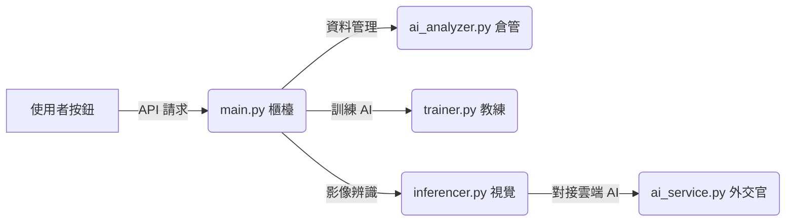

# AI Detector 系統設計流程與互動詳解 (V4.3)

這份文件將帶你從「按鈕點擊」一路追蹤到「後端程式碼執行」。

---

## 1. 後端核心組件詳解 (Core Backend Modules)

這幾位「後端工程師」透過 API 協同作業，確保系統從資料處理到模型部署的流程流暢。

| 檔案名稱 (`.py`) | 技術定位 | 深度職責說明 |
| :--- | :--- | :--- |
| **`main.py`** | **系統核心 / FastAPI 網關** | **樞紐中心**：負責所有 API 接口（Endpoint）的定義。除了路由分發，還負責管理系統全域狀態（如 `auto_label_status`）、處理檔案系統安全鎖定（OneDrive 衝突處理）以及靜態資源 (`/static`, `/outputs`) 的掛載。 |
| **`inferencer.py`** | **AI 推理引擎 / OpenCV 處理器** | **影像分析核心**：負責加載 Ultralytics YOLO 模型進行推論。它處理圖片的預處理、座標解析（從 Tensor 轉為 JSON/YOLO 格式），並在「自動標記」場景中整合本地 YOLO 與雲端 LLM 的混合推論邏輯。 |
| **`trainer.py`** | **訓練調度員 / 子進程管理器** | **模型孵化中心**：負責將資料集結構動態編譯為 `data.yaml` 配置檔。它會啟動一個隔離的 `threading` 任務來執行模型訓練，並透過攔截標準輸出來實時更新訓練進度數據。 |
| **`ai_service.py`** | **LLM 接口 / 多模態通訊官** | **雲端腦神經**：封裝了 Google Gemini 與 Groq 的通訊協定。它負責處理「複雜語義理解」，例如將自然語言轉換為特定的自動標記指令 `[AUTO_LABEL:...]`。 |
| **`ai_analyzer.py`** | **資料科學家 / 統計模組** | **數值分析中心**：利用 `pathlib` 掃描整個 `data/datasets` 目錄。它會解析 YAML 與 CSV 文件，計算標籤分佈、統計資料集規模，並為前端提供診斷所需的基礎數據。 |

---

## 2. 深度流程追蹤：從點擊到底層執行

### 🟢 場景 A：建立資料集與結構初始化
1.  **前端動作**：使用者點擊「建立資料集」並選取檔案上傳。
2.  **API 接收**：`main.py` 透過 **`/api/datasets/upload_v2`** 接口接收 Form Data。
3.  **底層操作**：
    *   **目錄建立**：使用 `Path.mkdir(parents=True)` 在 `data/datasets/` 下建立以資料集為名的根目錄。
    *   **檔案儲存**：透過 `shutil.copyfileobj` 串流寫入上傳的檔案。
    *   **自動檢索**：`main.py` 會自動掃描新資料夾，檢測是否存在 `classes.txt` 或 `images/` 等結構。

### 🟡 場景 B：標記存檔與檔案鎖定處理
1.  **使用者動作**：在標記介面完成畫框，點擊「儲存標記」。
2.  **API 傳輸**：前端傳送 YOLO 格式的座標字串至 **`/api/datasets/save_label`**。
3.  **安全寫入**：
    *   `main.py` 會自動建立不存在的 `labels/` 子目錄。
    *   **重試機制**：針對 Windows/OneDrive 環境，實作了 3 次重試邏輯（每次間隔 0.5s），避免檔案被同步軟體鎖定而寫入失敗。

### 🔴 場景 C：自動標記 (AI 協助)
1.  **指令觸發**：在聊天室輸入「自動標記」。
2.  **雙層解析**：
    *   **本地解析**：`main.py` 優先從文字中提取已知資料集名稱。
    *   **AI 解析**：`ai_service.py` 輔助判斷使用者的意圖。
3.  **執行推理**：`inferencer.py` 啟動 `auto_label` 任務，遍歷資料夾內未標記的圖片。
4.  **進度回報**：系統透過全域變數 `auto_label_status` 即時更新處理張數，前端則透過 **`/api/ai/auto_label_status`** 輪詢進度。

### 🔵 場景 D：模型訓練與自動部署
1.  **初始化**：點擊「啟動訓練」，調用 **`/api/train/start`**。
2.  **配置生成**：`trainer.py` 生成專屬的 `data.yaml`，明確標註訓練集與驗證集路徑。
3.  **非同步監控**：訓練在後台執行，使用者可透過 **`/api/train/status`** 觀看實時日誌。
4.  **自動部署**：訓練成功後，系統會自動從 `runs/train/exp/weights/` 抓取 `best.pt`，並改名複製到 `models/` 目錄下供即時切換。

### 🟣 場景 E：影像驗證與結果渲染
1.  **影像上傳**：調用 **`/api/verify/single`** 上傳測試圖。
2.  **推理計算**：`inferencer.py` 載入指定的 `.pt` 權重，執行 `model.predict()`。
3.  **路徑回傳**：推理結果儲存於 `data/outputs/`，`main.py` 回傳圖片路徑，前端透過掛載的 `/outputs` 靜態路徑顯示畫好框的成果。

### 📊 場景 F：模型效能診斷與可視化 (Evaluation Dashboard)
1.  **模型選取**：在診斷頁面選擇特定模型（如 `[花-訓練]_best.pt`）。
2.  **圖表載入**：前端調用 **`/api/model/evaluation/charts/{chart_name}`** 並帶上模型名稱參數。
3.  **數據檢索**：`main.py` 根據名稱定位到 `runs/train/[訓練名稱]/` 目錄，抓取 YOLO 生成的 `confusion_matrix.png`、`BoxF1_curve.png` 等專業報表。
4.  **AI 分析**：使用者在聊天室問「診斷我的模型」，`main.py` 會自動讀取 `results.csv` 並將 `mAP`、`Loss` 等數值餵給 AI 進行深度解讀。

---

## 3. 重要資料夾與產出詳解 (Deep Dive into Outputs)

系統執行訓練與偵測時，會自動在 `runs/` 資料夾下建立結構化的紀錄，這就像是 AI 的「實驗日誌」。

### 📁 `runs/detect/train/` (訓練實驗室)
這是 AI 學習過程的完整紀錄，包含以下關鍵檔案：
*   **`weights/` 資料夾**：
    *   **`best.pt`**：訓練過程中最聰明的模型（準確率最高），系統會自動將它複製到根目錄的 `models/` 資料夾供前端使用。
    *   **`last.pt`**：最後一次訓練存檔，用於中斷後可以從此處恢復訓練。
*   **圖表檔案 (Visual Analysis)**：
    *   **`results.png`**：訓練的「成績單」，顯示損失函數 (Loss) 如何下降、準確率如何上升。
    *   **`confusion_matrix.png`**：混淆矩陣，用來分析 AI 是否容易把 A 標籤誤看成 B 標籤。
    *   **`BoxPR_curve.png`**：精準度與召回率曲線，專業評估模型抓得「準不準」與「全不全」。
*   **參數紀錄**：
    *   **`args.yaml`**：記錄這次訓練使用的所有設定（如學習率、批次大小），方便日後復現結果。

### 📁 `runs/detect/predict/` (偵測成品區)
當你點擊「影像驗證」功能時，AI 會將分析後的結果存放在這裡：
*   **標記後的圖片**：在原圖上畫好框線、標註名稱與信心分數的成品。
*   **用途**：讓開發者可以快速檢查 AI 的辨識邏輯是否符合預期，也是網頁介面上顯示預測結果的檔案來源。

### 🔄 系統自動化邏輯
*   **自動遞增**：YOLO 引擎會自動管理這些資料夾。如果你執行第二次訓練，它會自動建立 `train2`，確保舊的實驗數據不會被覆蓋。
*   **搬運工 (Trainer)**：**`trainer.py`** 在訓練結束後，會主動從這裡抓取最優權重（`best.pt`）並部署到部署環境。

---

## 4. 視覺化流程圖

---

## 5. 資料集健康度：兩個入口有什麼不同？

我們設計了兩個地方可以看健康度，它們的功能分工完全不同：

1.  **三個點選單 -> 診斷資料集 (數據中心)**：
    *   **角色**：像是「體檢報告單」。
    *   **功能**：給你最精確的數字（分數、類別圓餅圖）。
    *   **場景**：當你想快速確認「標記進度到哪了？」或是「哪類標得比較多？」的時候使用。

2.  **AI 助理對話框 (診斷大腦)**：
    *   **角色**：像是「主治醫生」。
    *   **功能**：解讀數字背後的意義，並給出建議。
    *   **場景**：當你問「為什麼我的模型訓練效果不好？」時，AI 會結合健康度數據告訴你：「是因為你的類別 A 太少，建議你再多標記 50 張圖片。」

---

## 6. LLM 智慧中樞：數據流動與程式碼運行流程

當你在聊天室輸入一句話時，系統內部會經歷以下五個階段：

### 階段一：前端發起與環境抓取 (Frontend)
*   **程式碼位置**：`static/app.js` -> `sendChatMessage()`
*   **動作**：
    1. 抓取你輸入的文字。
    2. 自動附帶「目前狀態」（例如：當前選中的資料集是「花」、目前訓練到第幾輪）。
    3. 發送 POST 請求至 `/api/ai/chat`。

### 階段二：後端數據整合 (Backend Hub)
*   **程式碼位置**：`main.py` -> `ai_chat()`
*   **動作**：
    1. **意圖識別（雙軌制）**：系統採用「專屬詞 + 通用詞」兩層判斷機制：
        *   **健康度觸發**：訊息含有「健康」「品質」「體檢」時，啟動資料集分析。
        *   **模型觸發**：訊息含有「模型」「訓練」「效能」等專屬詞時，啟動模型分析。
        *   **通用詞處理**：「診斷」「分析」等通用詞，會依據是否同時出現健康度關鍵字來決定歸屬，兩者可共存。
    2. **數據注入**：
        *   **資料集健康**：調用 `ai_analyzer.py` 統計標籤分佈與健康分數。
        *   **模型效能**：自動識別訊息中的模型名稱（如 `[花-訓練]`），讀取 `results.csv` 提取 mAP 與 Loss。
    3. **背景包裝**：將「對話紀錄 + 系統狀態 + 體檢報告 + 模型數據」封裝成 `Context`。

### 階段三：AI 大腦決策 (LLM Engine)
*   **程式碼位置**：`ai_service.py` -> `chat()`
*   **動作**：
    1. **切換模型**：根據選單（Flash/Pro/Gemma）決定打哪一個 API。
    2. **專家推理**：AI 讀完背景資料後，生成人類看得懂的建議。
        *   **診斷行為**：如果看到 mAP 數據，AI 會自動對比 `mAP50` 與 `mAP50-95`，並觀察 Loss 是否有收斂。
    3. **指令埋設**：如果 AI 決定要標記或顯示圖表，它會在回覆末尾埋入特殊標籤，如 `[HEALTH_DATA: ...]` 或 `[AUTO_LABEL: ...] `。

### 階段四：指令解析與安全鎖 (The Parser)
*   **程式碼位置**：`main.py` (回傳給前端前)
*   **動作**：
    1. 解析 AI 的回覆內容。
    2. **安全驗證**：只有在使用者真的有提到「標記」相關字眼時，才會認可 AI 的 `[AUTO_LABEL]` 指令。
    3. 如果確認要標記，啟動後台執行緒。

### 階段五：結果呈現與視覺化 (Result)
*   **程式碼位置**：`static/app.js` -> `appendHealthCard()`
*   **動作**：
    1. 聊天室收到回覆文字。
    2. 如果偵測到 `[HEALTH_DATA]`，自動呼叫 **Chart.js** 在對話框裡畫出圓餅圖。

---

## 7. 程式碼模組對應表 (Full Project Map)

為了方便開發與維護，我們將系統拆分為多個功能專一的模組，以下是各個組件的深度詳解：

### 🚀 啟動與配置 (Root Directory)
| 檔案名稱 | 擔任角色 | 核心功能 |
| :--- | :--- | :--- |
| **`start_server.bat`** | **一鍵啟動腳本** | **系統入口**：自動啟動虛擬環境 (venv) 並執行 `main.py`，是進入系統的最快方式，避免手動輸入繁瑣指令。 |
| **`run.py`** | **啟動調度器** | **環境校驗**：負責檢查系統環境、自動尋找可用端口，並呼叫 Uvicorn 啟動後端，確保啟動過程不噴錯。 |
| **`requirements.txt`** | **套件清單** | **軟體清單**：記錄系統所需的所有 Python 函式庫（如 FastAPI, Ultralytics, OpenAI），確保環境一致性。 |
| **`.env`** | **機密鑰匙盒** | **金鑰管理**：儲存 API Key (Gemini, Groq) 與私密設定。這是一個隱藏檔，系統運作時會自動讀取。 |
| **`setup.bat`** | **初始化工具** | **安裝專家**：第一次下載專案後使用，自動建立虛擬環境並安裝所有依賴，完成「從無到有」的配置。 |

### 🧠 後端核心模組 (`/server`)
| 檔案名稱 | 擔任角色 | 核心功能 |
| :--- | :--- | :--- |
| **`main.py`** | **系統櫃檯** | **樞紐中心**：定義所有 API 接口，負責前端與後端的通訊橋樑，並管理全域狀態與檔案系統安全。 |
| **`ai_service.py`** | **外交官** | **大腦通訊**：統籌管理雲端 AI (Gemini, Groq, Ollama)，負責將系統數據轉換為 AI 能聽懂的「提示詞」。 |
| **`ai_analyzer.py`** | **健檢員** | **數據分析**：掃描資料集目錄、計算圖片張數與標籤比例，為診斷面板提供精確的統計數據。 |
| **`trainer.py`** | **教練** | **模型孵化**：啟動獨立執行緒進行 YOLO 訓練，實時攔截日誌並將進度與 Loss 數值回傳至前端。 |
| **`inferencer.py`** | **視覺官** | **影像辨識**：加載 `.pt` 權重執行推理。除了驗證圖片，也負責「自動標記」時的影像座標生成。 |
| **`optimization_api.py`** | **輔助工具** | **效能增強**：提供模型轉換或清理快取的專屬 API，確保系統長時間運行依然流暢。 |

### 🎨 前端介面與互動 (`/server/static`)
| 檔案名稱 | 擔任角色 | 核心功能 |
| :--- | :--- | :--- |
| **`index_v3.html`** | **主舞台** | **核心 UI**：系統的主畫面，整合了訓練控制台、影像驗證與最新的模型診斷儀表板。 |
| **`app.js`** | **前端大腦** | **互動邏輯**：負責所有按鈕的監聽、非同步 API 呼叫、Chart.js 圖表渲染與 WebSocket 狀態更新。 |
| **`style.css`** | **造型師** | **視覺規範**：定義了毛玻璃質感、動態漸層與響應式佈局，讓系統具備專業且高端的介面美感。 |
| **`datasets.html`** | **資料倉儲** | **專屬介面**：提供資料集管理頁面，支持上傳、刪除與快速瀏覽資料集規模。 |
| **`labeling.html`** | **標記工作檯** | **工作介面**：提供專用的圖片標記畫布，支持手動畫框與 AI 輔助標記的即時結果呈現。 |

### 📁 系統資源資料夾 (Data & Assets)
*   **`/models`**：**部署區**，存放隨時可供切換的訓練成果 (`.pt`) 檔案。
*   **`/runs`**：**紀錄區**，存放 YOLO 訓練自動生成的專業曲線圖與實驗日誌，診斷功能即是從此讀取。
*   **`/data/datasets`**：**儲藏室**，存放原始圖片檔案與對應的標籤文字檔。
*   **`/data/uploads`**：**轉運站**，暫存從網頁端上傳的原始檔案，經系統校驗後才會搬移至儲藏室。
*   **`/data/outputs`**：**成品區**，存放 AI 辨識完畢、畫好標記框的結果圖片，供網頁前端即時展示。

